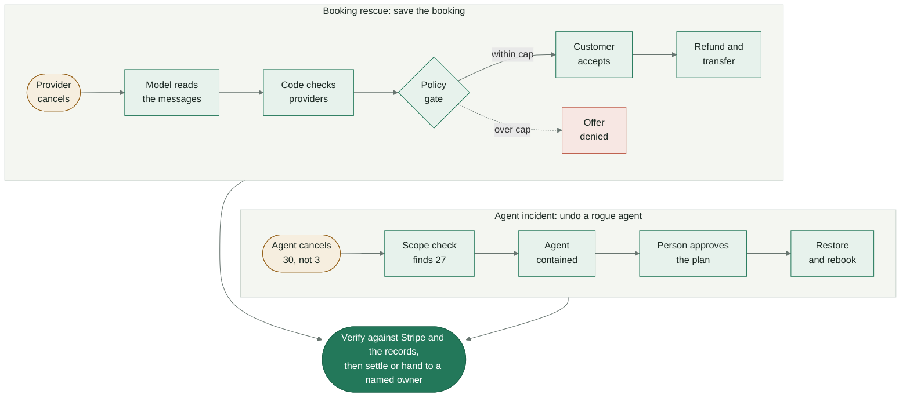
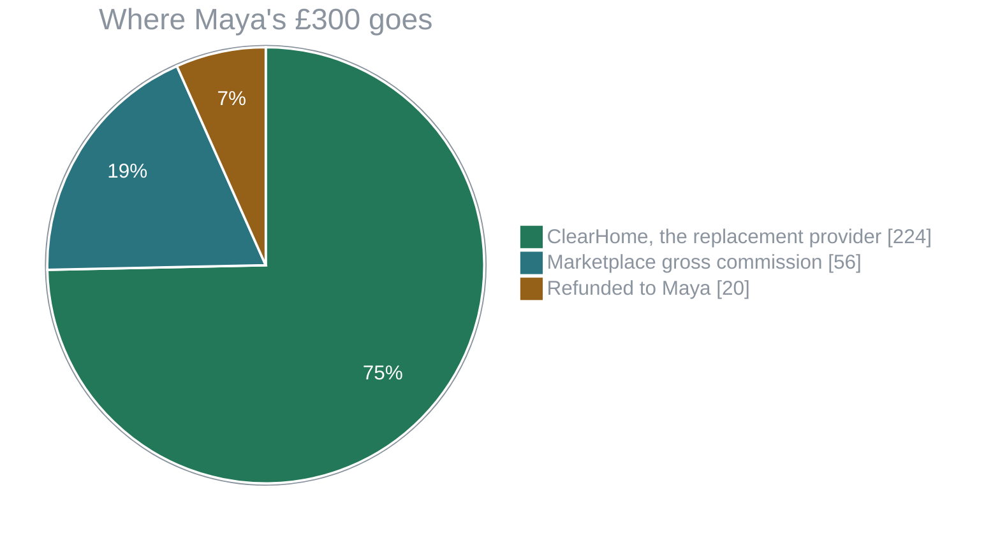
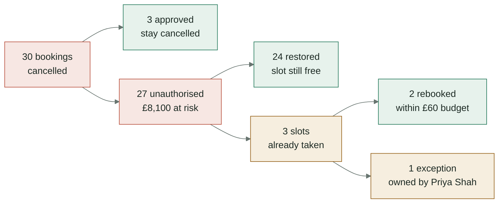

<div align="center">


# ArchOS

**When a transaction breaks, the business outcome shouldn't have to.**

A provider cancels a paid booking. ArchOS finds a replacement, negotiates inside fixed policy limits, gets the customer's consent, and moves real Stripe money to make it right. Then it proves every step against Stripe.


|    **£300**     |         **£20**          |         **£224**         |            **27**            |
| :-------------: | :----------------------: | :----------------------: | :--------------------------: |
| booking at risk | refunded to the customer | paid to the new provider | rogue cancellations repaired |

</div>

> **Sample workspace:** every company, person and booking is sample data. Stripe runs in test mode only.

## Contents

- [A refund isn't a rescue](#a-refund-isnt-a-rescue)
- [How it works](#how-it-works)
- [Booking rescue: save the booking](#booking-rescue-save-the-booking)
- [Agent incident: 30 cancelled instead of 3](#agent-incident-30-cancelled-instead-of-3)
- [Quick start](#quick-start)
- [Walk through a recovery](#walk-through-a-recovery)
- [Configuration](#configuration)
- [Development](#development)
- [Deployment](#deployment)
- [Limits](#limits)

## A refund isn't a rescue

Maya paid £300 for a man and van to move her flat on Friday. On Friday morning the van breaks down and the provider cancels. A refund gives Maya her money back, but she still has to be out by 3pm, and the marketplace loses the booking and its commission.

ArchOS turns that failure into a recovered booking:

1. **Understands the need.** A model reads the provider's and customer's messages and turns them into constraints: done by 3pm, two movers, a Luton van, no extra cost.
2. **Finds real supply.** It checks providers already on the marketplace. Code, not the model, decides who is eligible.
3. **Negotiates within policy.** It bargains with providers. A fixed subsidy cap blocks any deal the marketplace can't fund.
4. **Gets consent.** The customer sees exactly what changes. Nothing happens until they accept.
5. **Moves the money.** A partial refund to the customer and a transfer to the new provider, through Stripe.
6. **Verifies the outcome.** Nothing counts until Stripe confirms it. Anything ArchOS can't fix goes to a named person with a deadline.

The same engine also repairs AI agent mistakes. When an ops agent cancels 30 bookings instead of 3, ArchOS contains the agent, restores what it can, rebooks what it can't, and hands the last case to a person.

ArchOS never breaks four rules:

- **The model proposes, code decides.** The model only extracts constraints. Eligibility, price caps, consent and funding are fixed checks.
- **No money moves without consent and a fresh recheck.** Hold, consent, slot and funds are verified again right before every commit.
- **Money moves once.** Each payment's operation ID is also its Stripe idempotency key, so a retry gets back the same refund or transfer.
- **Nothing is rounded up.** Pending stays pending, unconfirmed stays unconfirmed, and unresolved cases get an owner.

## How it works



The UI holds no business state. Each button posts one action. The browser then keeps advancing the engine until it reaches a step a person decides, so the agent's work runs without clicks. The engine claims each step with a lock in MongoDB so a double click runs it once, every tool call passes through the gateway, and the response is the full new state.

| Part         | What it does                                                                                       | Where                                            |
| ------------ | -------------------------------------------------------------------------------------------------- | ------------------------------------------------ |
| Agent        | Turns free-text messages into structured constraints, with sanity checks and fixed fallback values | [`src/agent/extract.ts`](src/agent/extract.ts)   |
| Gateway      | Runs every tool call through scope and policy checks, and writes the audit trail                   | [`src/engine/gateway.ts`](src/engine/gateway.ts) |
| Policy       | Eligibility, subsidy cap, hold, consent, funding, and fair allocation of scarce slots              | [`src/engine/policy.ts`](src/engine/policy.ts)   |
| Money outbox | Writes the intent first, calls Stripe with the op ID as idempotency key, then reads it back        | [`src/money/ops.ts`](src/money/ops.ts)           |
| Journal      | Balanced entries built only from operations Stripe confirmed                                       | [`src/ledger/journal.ts`](src/ledger/journal.ts) |

## Booking rescue: save the booking

_"The provider cancelled. Save the booking."_ QuickMove's van breaks down on the morning of Maya's move.

| Step       | What happens                                                                                                   | Triggered by                                    |
| ---------- | -------------------------------------------------------------------------------------------------------------- | ----------------------------------------------- |
| Charge     | A real Stripe test PaymentIntent for £300                                                                      | Start recovery                                  |
| Failure    | QuickMove cancels. £300 of booking value is at risk                                                            | Runs automatically                              |
| Understand | A live model extracts: done by Fri 15:00, two movers, Luton van, max £300                                      | Runs automatically                              |
| Search     | Four providers are checked in code. Two fail the constraints                                                   | Runs automatically                              |
| Boundary   | BrightNest wants £340. That needs a £40 subsidy against a £20 cap, so policy blocks it                         | Runs automatically                              |
| Negotiate  | ClearHome quotes £290, accepts £280, and holds the slot for 30 minutes                                         | Runs automatically                              |
| Propose    | Maya sees the offer: £280 price, £20 back, £224 to the provider, £56 gross commission, £0 subsidy              | Send offer to Maya                              |
| Consent    | Nothing moves until Maya accepts. Consent expires with the hold                                                | Runs automatically, then waits for the customer |
| Secure     | Hold, consent, slot and money are rechecked. The booking is reassigned and the £20 refund is sent and verified | Accept replacement (customer view)              |
| Fulfil     | Recorded when the provider reports the job complete                                                            | Report job complete (provider view)             |
| Settle     | Only now is ClearHome paid £224, as a Stripe transfer tied to Maya's original charge                           | Release provider payment                        |
| Ledger     | A balanced journal built only from verified Stripe operations                                                  | Runs automatically after settle                 |

A booking only counts as saved once it reaches the top of the ladder: **Offered, Secured, Fulfilled, Settled**. The new provider is never paid before fulfilment.



The £56 is gross commission before fees, not profit.

## Agent incident: 30 cancelled instead of 3

Sam Okafor approves an ops agent to cancel 3 Harbour Lettings bookings in task OPS-311. The agent cancels all 30.



Along the way, ArchOS:

- compares the changed bookings with the approved list, which is stored apart from the agent;
- suspends the agent's write tools, keeps its reads on, and blocks its next call to email all 30 tenants;
- waits for a person to approve the exact recovery plan before restoring anything;
- gives scarce replacement slots to the earliest service time first, within the incident budget. Commission is not an input.

### Screens

The sidebar lists six pages. The top bar has a health pill, green when MongoDB and Stripe are reachable and otherwise naming what is down, and a bell that lists what waits on the operator.

| Route         | What it shows                                                                                                                                                                     |
| ------------- | --------------------------------------------------------------------------------------------------------------------------------------------------------------------------------- |
| `/`           | Overview: the single next action, four stat cards, your recovery inbox, and the latest activity                                                                                   |
| `/case`       | Recoveries: the Booking rescue for Maya Chen (BK-1042), milestones, a next-step card, and tabs for Recovery plan, Provider options, Messages, Money, Agent reasoning and Activity |
| `/incident`   | Incidents: the Harbour Lettings agent incident with the plan, incident budget, what still needs a person, affected bookings, agent activity and containment                       |
| `/exceptions` | Open exceptions with owner, next action and due time. Refund now or Retry, then close with a note                                                                                 |
| `/history`    | Activity: a timeline, the append-only log, a "Download report" JSON, and the case or verification report                                                                          |
| `/rules`      | Recovery rules: the subsidy cap, incident budget and hold minutes from config, plus the Offered, Secured, Fulfilled, Settled ladder                                               |

Only one case is loaded at a time. Opening the other case loads it fresh and clears the current case's progress. Reset lives in the profile button at the bottom of the sidebar: **Reset workspace**, then confirm.

## Quick start

| Need            | Why                                                                                  |
| --------------- | ------------------------------------------------------------------------------------ |
| Node 22 and npm | Runtime                                                                              |
| MongoDB         | A replica set, because the engine uses transactions. A free Atlas cluster works      |
| Stripe account  | Test mode with Connect enabled, so the setup script can create the ClearHome account |
| Nebius key      | Optional. Enables live constraint extraction through Nebius Token Factory            |

**1. Install**

```sh
npm install
```

**2. Create `.env.local`** (gitignored)

```sh
MONGODB_URI="mongodb+srv://<user>:<password>@<cluster>/"
STRIPE_SECRET_KEY="sk_test_..."
STRIPE_SETUP_SECRET_KEY="sk_test_..."
STRIPE_ACCT_CLEARHOME=""   # filled in by step 3
NEBIUS_API_KEY=""          # optional
```

The app refuses to boot unless `STRIPE_SECRET_KEY` starts with `sk_test_` or `rk_test_`.

**3. Set up Stripe and the database**

```sh
npm run stripe:setup   # creates the sample ClearHome connected account
npm run stripe:spike   # proves charge, refund and transfer work in your sandbox
npm run db:setup       # creates indexes in archos, archos_test and archos_preview
```

`stripe:setup` prints `STRIPE_ACCT_CLEARHOME=acct_...`. Paste it into `.env.local` before the spike. If Stripe doesn't activate transfers automatically, the script creates an Express account instead and prints an onboarding link to finish by hand. `npm run stripe:setup link <acct_id>` prints a fresh link.

**4. Run**

```sh
npm run dev            # http://localhost:3000
```

The top-bar health pill should be green, meaning MongoDB and Stripe are reachable. Full details are at `/api/health`.

## Walk through a recovery

The full run takes about three minutes. Each button posts one action, and the agent's work between decisions runs on its own. If a step fails, the card shows the error and the button reads **Try again**. When `DEMO_KEY` is set, the browser asks once for an "Access key".

### Booking rescue script

| Screen           | Click                                                                               | Say                                                                                                              |
| ---------------- | ----------------------------------------------------------------------------------- | ---------------------------------------------------------------------------------------------------------------- |
| Overview         | none                                                                                | "You pay for a service and the provider cancels. A refund gives the money back, but you still need the service." |
| Recoveries       | **Start recovery**                                                                  | "Maya paid £300 for a man and van. That's a real Stripe test payment."                                           |
| failure          | runs automatically                                                                  | "Friday morning, QuickMove's van breaks down. Maya hands her keys back at 5pm."                                  |
| understand       | runs automatically                                                                  | "The agent reads both messages and pulls out what matters. That ran live on a model."                            |
| search           | runs automatically                                                                  | "It checks providers already on the marketplace. Two can't do the job."                                          |
| boundary         | runs automatically                                                                  | "BrightNest needs a £40 subsidy. The cap is £20. Blocked by policy, not by the model."                           |
| negotiate        | runs automatically, then stops                                                      | "ClearHome quotes £290. The agent offers £280. They accept and hold the slot."                                   |
| propose, consent | **Send offer to Maya**, then **View customer booking**, then **Accept replacement** | "Maya sees exactly what changes. Nothing happens until she says yes."                                            |
| secure           | runs after Accept replacement                                                       | "ArchOS rechecks everything, then rebooks and refunds £20, verified from Stripe."                                |
| fulfil, settle   | **View provider's job**, **Report job complete**, then **Release provider payment** | "ClearHome reports the job done. Only then is ClearHome paid £224."                                              |
| Money tab        | **View money breakdown**, then Replay on a payment row                              | "Retries never move money twice. Same transfer, same ID."                                                        |
| ledger           | runs with Release provider payment                                                  | "This is the journal finance needs, built only from verified Stripe facts."                                      |

To show the refusal path instead, choose **Choose a full £300 refund** then **Yes, refund me** in the customer view.

### Agent incident script

| Screen     | Click                                                                                      | Say                                                                                     |
| ---------- | ------------------------------------------------------------------------------------------ | --------------------------------------------------------------------------------------- |
| Incidents  | **Open Agent incident**, if the booking rescue is loaded                                   | "Sam approved an ops agent to cancel 3 bookings. It cancelled 30."                      |
| Incidents  | **Hand the task to Ops Agent**                                                             | "The agent reads and acts. ArchOS detects the overreach, contains the agent and plans." |
| plan       | **Review & approve plan**, tick "I approve this plan as Sam Okafor", then **Approve plan** | "Nothing is restored until a person approves the exact plan."                           |
| recovery   | runs automatically to the end                                                              | "Restore, rebook within budget, then verify."                                           |
| Exceptions | **Review open exceptions**                                                                 | "One booking can't be fixed. It has an owner, Priya Shah, and a deadline."              |

The approval dialog lists: restore 24 original bookings, budget for up to 3 replacement offers, and preserve 3 authorised cancellations. At the end, expect metrics 27 / 24 / 2 / 1, the budget card at £40 / £60 committed, and one open exception for BK-2026 on `/exceptions`.

Close with: _"Stripe moves the money. Briefcase makes it legible. ArchOS repairs the outcome when the transaction breaks."_

<details>
<summary><b>Before you present</b></summary>

1. Check `/api/health`: `mongo`, `stripe`, `stripeTestKey` and `clearhomeTransfers` should be `true`. `nebius` and `modelAvailable` too if you want live extraction. The top-bar health pill should be green.
2. Reset within 10 minutes of presenting, from the profile button at the bottom of the sidebar. The provider hold lasts 30 minutes from the negotiate step.
3. Open the Stripe dashboard in test mode, to show that the PaymentIntent, refund and transfer IDs match the Money tab.
4. Present from a production build (`npm run build && npm start`, or the deployed URL), not `npm run dev`.

</details>

<details>
<summary><b>If something goes wrong</b></summary>

| Symptom                                         | Do this                                                                                                 |
| ----------------------------------------------- | ------------------------------------------------------------------------------------------------------- |
| The card shows a Stripe error on charge         | Press **Try again**. The retry reuses the same idempotency key, so it can't double-charge               |
| Money row reads "Reconciling" or "Failed"       | Press Recheck on that row. A definitive failure opens an exception with a Retry button                  |
| Extraction badge says fallback                  | Expected without a model key, or when the model times out. Policy is unchanged                          |
| The customer view says "This offer has expired" | The hold ran out. Press **Choose a full £300 refund** then **Yes, refund me**, then reset the workspace |
| "Database unreachable" banner                   | Check your network and Atlas, then press Retry                                                          |
| 409 toast after a double click                  | Ignore it. The step ran once                                                                            |

</details>

## Configuration

Local values go in `.env.local` (gitignored).

### Core

| Variable          | Default       | Notes                                                        |
| ----------------- | ------------- | ------------------------------------------------------------ |
| `MONGODB_URI`     |               | Required                                                     |
| `MONGODB_DB`      | `archos`      | Database the app uses                                        |
| `MONGODB_TEST_DB` | `archos_test` | Reset by the acceptance tests. Must differ from `MONGODB_DB` |

### Stripe

| Variable                  | Default | Notes                                                                   |
| ------------------------- | ------- | ----------------------------------------------------------------------- |
| `STRIPE_SECRET_KEY`       |         | Required. `sk_test_` or `rk_test_` only. Live keys stop the app booting |
| `STRIPE_SETUP_SECRET_KEY` |         | Full `sk_test_` key, used only by `npm run stripe:setup`                |
| `STRIPE_ACCT_CLEARHOME`   |         | Connected account that receives the £224 transfer                       |
| `STRIPE_VERIFY_TRIES`     | `5`     | Stripe read-back polls per money operation                              |

The `stripe` SDK (23.0.0) pins API version `2026-09-30.endive`. Charges use the `pm_card_bypassPending` test card, so funds are available for the transfer straight away.

### Model

| Variable          | Default           | Notes                                       |
| ----------------- | ----------------- | ------------------------------------------- |
| `NEBIUS_API_KEY`  |                   | Enables live constraint extraction          |
| `NEBIUS_MODEL`    | `zai-org/GLM-5.3` |                                             |
| `LIVE_EXTRACTION` | on                | `off` forces the fixed fallback constraints |

### Access and policy

| Variable            | Default | Notes                                                                      |
| ------------------- | ------- | -------------------------------------------------------------------------- |
| `DEMO_KEY`          |         | Access key. When set, the browser asks for it once and every POST needs it |
| `HOLD_MINUTES`      | `30`    | Provider hold and consent lifetime                                         |
| `SUBSIDY_CAP_PENCE` | `2000`  | Per-case subsidy cap (£20)                                                 |
| `STEP_PACE_MS`      | `60`    | Delay between incident recovery items, for the animation                   |

## Development

| Command                       | What it does                                                      |
| ----------------------------- | ----------------------------------------------------------------- |
| `npm run dev`                 | Dev server at http://localhost:3000                               |
| `npm run build` · `npm start` | Production build and server                                       |
| `npm test`                    | Unit tests. No database or network, about 2 seconds               |
| `npm run test:acceptance`     | End-to-end runs against `MONGODB_TEST_DB` and your Stripe sandbox |
| `npm run typecheck`           | TypeScript                                                        |
| `npm run lint`                | ESLint                                                            |
| `npm run format`              | Prettier                                                          |

Acceptance tests reset their database, so they refuse to run if `MONGODB_TEST_DB` equals `MONGODB_DB`. They force the fixed fallback extraction so they never call the model.

### Project structure

| Directory       | Purpose                                                                  |
| --------------- | ------------------------------------------------------------------------ |
| `src/app`       | Next.js pages and the `/api/demo`, `/api/state` and `/api/health` routes |
| `src/engine`    | Steps, gateway, policy, incident detection, recovery, exceptions, store  |
| `src/money`     | Stripe client, payment outbox, verification, reconciliation, split maths |
| `src/ledger`    | Journal built from verified money                                        |
| `src/agent`     | Live constraint extraction and its sanity checks                         |
| `src/scenarios` | The two cases: seed data, tools and recovery plans                       |
| `src/ui`        | React views and components                                               |
| `scripts`       | Stripe and database setup, Stripe spike                                  |
| `tests`         | `unit` runs offline; `acceptance` runs against MongoDB and Stripe        |

## Deployment

The app targets Vercel in region `lhr1` ([`vercel.json`](vercel.json)), with Atlas in AWS `eu-west-2`. Set the same environment variables in Vercel. Use `MONGODB_DB=archos` for production and `archos_preview` for previews, so a preview never touches the production workspace. Check `/api/health` after every deploy: it returns `503` if MongoDB or Stripe is unreachable.

## Limits

Current limits:

- Sample data and Stripe test mode only.
- No authentication beyond the optional access key.
- One shared workspace state per database. Reset clears it for everyone.
- Fulfilment is recorded from the provider's report, not independently confirmed.
- The model only extracts constraints. The full live agent loop is not wired in.
- The journal is not posted to Briefcase.
- Gross commission is not profit.
